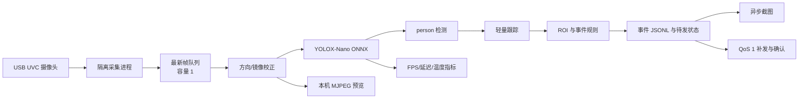

# EdgeVision 项目复现与工程解读

## 1. 系统概述

EdgeVision 是一个运行在 Raspberry Pi 5 4GB 上的端侧人员检测系统。它从 USB UVC 摄像头读取视频，在本地使用 YOLOX-Nano ONNX 模型检测 `person`，可按配置启用多边形 ROI，也可关闭区域限制进行全画面检测；事件通过轻量跟踪和状态规则落盘为 JSONL，并向本机 Mosquitto MQTT 发布告警。

各模块的实现入口与验证用例见[模块与测试索引](docs/modules.md)。

## 2. 项目背景

固定机位使用单个 UVC 摄像头监测多边形区域。视频在设备上处理，区域事件在本地落盘，并可通过 MQTT 通知订阅端。网络中断时，设备可继续检测并记录事件。

## 3. 项目目录

```text
edgevision/
├── README.md                    # 安装、运行和实际限制
├── PROJECT_GUIDE.md             # 系统架构、模块职责和实机验证
├── SAFETY.md                    # 树莓派项目目录边界和清理规则
├── pyproject.toml               # Python 包、依赖和 CLI 入口
├── config.example.yaml          # 通用视频回放示例，不含设备私有配置
├── config.local.yaml            # 树莓派真实摄像头配置，忽略、不提交
├── models/
│   ├── manifest.json            # 模型来源、输入约定、派生模型和 SHA-256
│   ├── YOLOX-LICENSE.txt        # YOLOX 上游许可证文本
│   ├── yolox_nano.onnx          # 原始 416×416 YOLOX-Nano
│   ├── yolox_nano_352.onnx      # 固定输入尺寸 352 的派生版本
│   └── yolox_nano_320.onnx      # 当前树莓派使用的 320×320 派生版本
├── data/
│   ├── README.md                # 固定样例、隐私数据和评测划分规则
│   ├── videos/                  # 固定回放视频和本地真实视频
│   └── images/                  # 截图及单图样例，真实图片不提交
├── src/edgevision/
│   ├── types.py                 # Frame、Detection、Track、Event 数据类型
│   ├── config.py                # YAML 配置读取和边界校验
│   ├── geometry.py              # 底部中心点、ROI 多边形判断
│   ├── detector.py              # YOLOX ONNX 预处理、解码和 NMS
│   ├── sources.py               # 视频回放、隔离式 UVC 摄像头和方向校正
│   ├── frame_queue.py           # 容量为 1 的最新帧队列
│   ├── tracker.py                # IoU/质心轻量跟踪
│   ├── events.py                 # ROI 进入、离开和冷却规则
│   ├── storage.py                # JPEG、JSONL、容量和保留策略
│   ├── mqtt_client.py            # 有界 QoS 1 MQTT 发布器
│   ├── preview.py                # 本机回环 MJPEG 预览页面
│   ├── metrics.py                # FPS、延迟、RSS、温度和降频指标
│   ├── pipeline.py               # 采集到告警的主流水线
│   ├── cli.py                    # check/infer/replay/run 等命令
│   ├── assets.py                 # 固定公开素材下载和哈希校验
│   └── evaluation.py             # 事件级 TP/FP/FN 和匹配评测
├── tests/                       # 单元、集成、边界和启动脚本测试
├── scripts/
│   ├── run.sh                    # 树莓派本机一键运行入口
│   ├── setup.sh                  # 项目虚拟环境和依赖安装
│   ├── start_service.sh          # 临时 systemd 用户服务
│   └── build_fast_model.py       # PC 端生成固定小输入模型
├── systemd/edgevision.service    # 项目内参考 unit，不安装到系统目录
└── benchmarks/
    ├── README.md                # 指标口径、优化对照和限制
    └── results/                 # 原始 JSON、CSV 和验证日志
```

`.venv`、`.wheelhouse`、模型文件、真实截图和运行输出都属于项目目录中的运行材料。树莓派真实配置 `config.local.yaml` 和包含摄像头画面的文件不提交仓库。目录清理边界写在 [SAFETY.md](SAFETY.md) 中。

## 4. 系统整体结构



系统按配置先旋转画面，再执行水平镜像。检测、跟踪、ROI 判定和预览共用校正后的图像坐标。

采集和推理是解耦的。摄像头产生新帧时，如果推理还没有处理完，队列会丢弃旧帧，只留下最新帧。这样会牺牲部分帧处理数量，但可以阻止延迟无限累积。对于实时告警，几十秒前的画面通常比丢掉中间帧更没有价值。

## 5. 模块职责

### 5.1 配置与数据类型

[配置解析](src/edgevision/config.py)定义输入设备、模型、ROI、MQTT 和输出目录。[公共数据类型](src/edgevision/types.py)定义模块之间传递的对象。

- `Frame`：一帧图像、序号、采集时间和来源时间。
- `Detection`：一个人员框、置信度和类别名。
- `Track`：检测框经过短时关联后的轨迹。
- `Event`：进入或离开事件，以及时间、ROI、轨迹和截图路径。

### 5.2 模型推理

[detector.py](src/edgevision/detector.py) 是模型适配层。它完成四件事：

1. 将 BGR 图像按 YOLOX 约定缩放并放入 416、352 或 320 的固定输入张量。
2. 保持 BGR 和 `0..255` 数值范围，不错误地转换成 RGB 或除以 255。
3. 将 YOLOX 原始输出按 stride 8、16、32 网格解码为边界框。
4. 计算 objectness × person class probability，并通过 NMS 去除重叠框。

树莓派当前使用 `yolox_nano_320.onnx`。这个模型不是重新训练的量化模型，而是从固定的官方 YOLOX-Nano 模型派生出 320 输入版本；生成脚本会验证 ONNX 结构，并逐个确认 initializer 权重字节没有变化。程序实际开始推理前还会验证模型哈希和 `models/manifest.json` 中的派生关系。

### 5.3 视频输入与最新帧队列

[sources.py](src/edgevision/sources.py) 包含两类输入：

- `VideoFileSource`：用于可重复的固定视频回放。
- `UvcCameraSource`：把可能卡在 V4L2 `read()` 的摄像头放到子进程中；子进程异常或超时后，父进程只重启摄像头采集进程。

[frame_queue.py](src/edgevision/frame_queue.py) 实现容量为 1 的最新帧队列。V4L2 驱动缓冲设置为 2，应用层队列仍只保留一帧；树莓派当前请求 20 FPS，使输入节奏接近 320 模型的处理能力，减少过载丢帧。UVC 子进程启动时预热自动对焦并锁定当前焦点，异常时由父进程重连。

### 5.4 ROI、跟踪与事件

[geometry.py](src/edgevision/geometry.py) 不判断人体框是否与 ROI 有面积交集，而是使用人员框的底部中心点。这更接近“人的脚是否进入地面区域”的业务含义。

[tracker.py](src/edgevision/tracker.py) 用 IoU 和质心做轻量的一对一关联，维护短暂的轨迹 ID。它不是 ByteTrack 或 DeepSORT，优点是 CPU 开销小、依赖少，缺点是遮挡和多人交叉场景下的稳定性有限。

[events.py](src/edgevision/events.py) 根据轨迹底部中心点的 ROI 状态产生 `person_entered` 和 `person_left`，通过冷却时间减少重复告警。它不会在检测暂时丢失时凭空生成离开事件。

### 5.5 事件存储与 MQTT

检测线程先持久化事件 ID、元数据及启用 MQTT 时的待发状态。截图在线程中异步编码，写入成功后按 ID 更新 `snapshot_path`。截图队列拥塞、画面模糊或截图超出配额时，元数据仍可查。清理会先核算可回收容量，并保护所有待确认记录。

[mqtt_client.py](src/edgevision/mqtt_client.py) 使用本机 Mosquitto 和 QoS 1。发布器有有限的排队和 inflight 数量，MQTT 暂时不可用时不阻塞本地检测。`mqtt_published`/“已接收”表示 Paho 接受了发布请求；只有 `mqtt_acknowledged`/“Broker 已确认”表示收到了 QoS 1 PUBACK，仍不代表订阅端业务已经处理完成。待发状态保存在事件 JSONL 中。重连和进程重启都会重新扫描待发记录，值班端使用 `edgevision receive` 按事件 ID 去重、保存收件凭据。详见[运行指南](docs/runtime.md)。

### 5.6 流水线与命令行

[pipeline.py](src/edgevision/pipeline.py) 把前面所有模块串起来。重点关注 `_process()`：方向校正、模型检测、轨迹更新、事件生成、存储、MQTT、指标和预览都从这里经过。

[cli.py](src/edgevision/cli.py) 是使用入口：

- `check`：检查摄像头或视频输入，并可保存校正后的截图。
- `infer`：对指定图片做单图推理和标注输出。
- `replay`：只回放固定视频，不打开 USB 摄像头。
- `run`：启动实时流水线，可打开本机预览。
- `benchmark`：执行基准测试。
- `assets`、`model-manifest`：下载或验证固定素材和模型。

## 6. 部署与历史实测

以下命令假设仓库位于用户主目录下。

```bash
cd ~/edgevision
sh scripts/run.sh
```

该脚本在树莓派的 Wayland 桌面会话中打开 Chromium，连接树莓派上的预览服务。通过笔记本浏览器查看时，可按[摄像头与实时预览](README.md#摄像头与实时预览)建立 SSH 端口转发。

以下历史短测来自真实 USB 摄像头和树莓派到 Windows 的实际传输链路：

| 指标                   |               结果 |
| ---------------------- | -----------------: |
| 摄像头请求帧率         | 30 FPS（历史基线） |
| 实际采集帧率           |          28.38 FPS |
| 实际推理处理帧率       |          21.28 FPS |
| 电脑端连续预览接收帧率 |          21.33 FPS |
| 推理耗时 p95           |              41 ms |
| 软件帧延迟 p95         |              78 ms |
| 最高温度               |           63.35°C |
| 降频标志               |            `0x0` |
| 处理错误               |                  0 |
| 历史基线队列丢帧比例   |              24.7% |

浏览器预览从旧的约 6.16 FPS 提升到约 21.33 FPS，主要原因是改成连续 MJPEG 流，并将绘制和 JPEG 编码从推理线程移出；检测速度提升主要来自 320×320 固定输入模型和 V4L2 双缓冲。

固定 20 帧对照中，416 输入模型 ORT 中位耗时约 60.70 ms，352 约 41.28 ms，320 约 34.02 ms。320 模型与原模型的输出框 IoU≥0.5 匹配比例为 83.82%。这个比例只能说明输出变化，不能当成人工标注集上的准确率、召回率或 mAP。

上一版的本地自动化结果为 169 项通过、2 项跳过，树莓派同步后为 170 项通过、1 项跳过。已完成模型校验、视频回放、MQTT 往返、摄像头短时运行、方向和镜像校正、本机 GUI 启动以及预览停止验证。2～8 小时稳定性、真实 USB 物理拔插恢复和目标机位人工标注评测仍待验证。公开短片的独立标注评测见[性能实验](benchmarks/README.md)。

## 7. 后续验证与改进方向

### 7.1 准确率和模型能力

- 建立按拍摄片段划分的真实测试集，标注边界框和进入/离开时间，报告 Precision、Recall、F1 和必要时的 mAP50。
- 针对远处小目标、逆光、夜间和遮挡场景重新选择输入尺寸或训练蒸馏模型。320 输入带来了速度收益，但不能默认它对所有距离和光线都更好。
- 评估 INT8 量化、TensorRT、NCNN 或 RKNN 等后端，必须用同一数据和同一指标比较，而不是只比较 FPS。
- 对摄像头安装高度、镜头畸变和 ROI 进行标定。当前 ROI 是归一化图像平面多边形，复杂场景可以升级为地面平面或透视变换。

### 7.2 跟踪和事件语义

- 多人密集、遮挡和交叉场景可以评估 ByteTrack、OC-SORT 或带 Kalman 预测的方案。
- 进入事件可以加入连续 N 帧确认、最小停留时间、滞回区域和轨迹置信度，减少框抖动造成的进出事件。
- 建立事件回放评测工具，自动计算重复告警、漏报、误报、事件延迟和轨迹断裂。

### 7.3 系统部署和运维

- 当前服务是项目内的临时 user systemd 服务；生产部署应提供正式 unit、开机策略、日志轮转、健康检查和升级回滚。
- 增加配置版本、模型版本、摄像头序列号和运行实例 ID，方便现场排障。
- MQTT 应增加认证、TLS、ACL、消息持久化策略和明确的告警确认机制。
- 预览端目前是本机回环无认证页面，生产环境应增加身份验证、访问控制或完全关闭预览。
- 应加入摄像头热拔插、模型损坏、磁盘满、Mosquitto 重启、进程崩溃和温度过高的自动化故障演练。

### 7.4 工程质量和可观测性

- 完成 2～8 小时稳定性测试，记录 RSS、队列丢帧、温度、降频和事件延迟随时间的曲线。
- 完成真实 USB 拔插恢复测试，确认重连次数、恢复时间和事件状态处理符合预期。
- 把 benchmark 结果接入 CI，防止模型或代码改动后 FPS、延迟和内存回退。
- 对日志做结构化输出，并为采集、推理、存储、MQTT 和预览分别增加健康状态。
