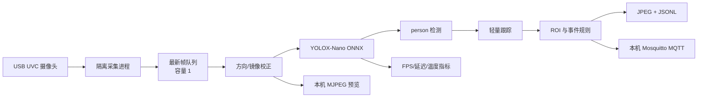

# EdgeVision 项目复现与工程解读

## 1. 项目一句话介绍

EdgeVision 是一个运行在 Raspberry Pi 5 4GB 上的端侧人员检测系统。它从 USB UVC 摄像头读取视频，在本地使用 YOLOX-Nano ONNX 模型检测 `person`，可按配置启用多边形 ROI，也可关闭区域限制进行全画面检测；事件通过轻量跟踪和状态规则落盘为 JSONL，并向本机 Mosquitto MQTT 发布告警。

它的核心价值是把“采集、推理、跟踪、事件、存储、告警、预览和运行监控”组织成一个可以在 ARM64 边缘设备上运行的完整工程，而不是只完成一段单张图片推理代码。

第一次学习时，建议先按 [LEARNING_PATH.md](LEARNING_PATH.md) 的阶段顺序阅读；本文保留完整的工程背景、实现取舍和实测记录，适合在走完基础路线后查阅。

## 2. 项目背景

云端视频分析通常需要持续上传视频，带来网络依赖、带宽成本和隐私风险。门店、仓库、实验室、工厂和园区中的很多场景只关心一件事：某个人是否进入了某个区域。把检测放到摄像头附近的树莓派上，可以只上传事件和截图，降低持续传输需求，并在网络暂时不可用时继续完成本地检测。

本项目把范围固定为单摄像头、单类别 `person` 和单机事件检测，刻意避开人脸识别、多摄像头融合、云端平台和训练系统。这样可以集中体现嵌入式视觉项目中更容易被忽略的工程问题：摄像头输入不稳定、推理速度跟不上采集、失焦图片、事件重复触发、磁盘持续增长、MQTT 不可用、画面方向错误，以及如何用可复现指标做取舍。

## 3. 项目目录

```text
edgevision/
├── README.md                    # 安装、运行和实际限制
├── PROJECT_GUIDE.md             # 本文：项目讲解、理解路径和简历价值
├── SAFETY.md                    # 树莓派项目目录边界和清理规则
├── pyproject.toml               # Python 包、依赖和 CLI 入口
├── config.example.yaml          # 通用视频回放示例，不含设备私有配置
├── config.local.yaml            # 树莓派真实摄像头配置，忽略、不提交
├── models/
│   ├── manifest.json            # 模型来源、输入约定、派生模型和 SHA-256
│   ├── YOLOX-LICENSE.txt        # YOLOX 上游许可证文本
│   ├── yolox_nano.onnx          # 原始 416×416 YOLOX-Nano
│   ├── yolox_nano_352.onnx      # 固定输入尺寸 352 的派生版本
│   └── yolox_nano_320.onnx      # 当前树莓派使用的 320×320 派生版本
├── data/
│   ├── README.md                # 固定样例、隐私数据和评测划分规则
│   ├── videos/                  # 固定回放视频和本地真实视频
│   └── images/                  # 截图及单图样例，真实图片不提交
├── src/edgevision/
│   ├── types.py                 # Frame、Detection、Track、Event 数据类型
│   ├── config.py                # YAML 配置读取和边界校验
│   ├── geometry.py              # 底部中心点、ROI 多边形判断
│   ├── detector.py              # YOLOX ONNX 预处理、解码和 NMS
│   ├── sources.py               # 视频回放、隔离式 UVC 摄像头和方向校正
│   ├── frame_queue.py           # 容量为 1 的最新帧队列
│   ├── tracker.py                # IoU/质心轻量跟踪
│   ├── events.py                 # ROI 进入、离开和冷却规则
│   ├── storage.py                # JPEG、JSONL、容量和保留策略
│   ├── mqtt_client.py            # 有界 QoS 1 MQTT 发布器
│   ├── preview.py                # 本机回环 MJPEG 预览页面
│   ├── metrics.py                # FPS、延迟、RSS、温度和降频指标
│   ├── pipeline.py               # 采集到告警的主流水线
│   ├── cli.py                    # check/infer/replay/run 等命令
│   ├── assets.py                 # 固定公开素材下载和哈希校验
│   └── evaluation.py             # 事件级 TP/FP/FN 和匹配评测
├── tests/                       # 单元、集成、边界和启动脚本测试
├── scripts/
│   ├── run.sh                    # 树莓派本机一键运行入口
│   ├── setup.sh                  # 项目虚拟环境和依赖安装
│   ├── start_service.sh          # 临时 systemd 用户服务
│   └── build_fast_model.py       # PC 端生成固定小输入模型
├── systemd/edgevision.service    # 项目内参考 unit，不安装到系统目录
└── benchmarks/
    ├── README.md                # 指标口径、优化对照和限制
    └── results/                 # 原始 JSON、CSV 和验证日志
```

`.venv`、`.wheelhouse`、模型文件、真实截图和运行输出都属于项目目录中的运行材料。树莓派真实配置 `config.local.yaml` 和包含摄像头画面的文件不提交仓库。目录清理边界写在 [SAFETY.md](SAFETY.md) 中。

## 4. 系统整体结构



处理顺序很关键：摄像头原始画面先旋转 180°，再做水平镜像，然后才进入模型、ROI、跟踪、截图和预览。因此检测框和告警区域都使用同一套校正坐标。当前真实设备配置是 `rotation: 180`、`mirror_horizontal: true`。

采集和推理是解耦的。摄像头产生新帧时，如果推理还没有处理完，队列会丢弃旧帧，只留下最新帧。这样会牺牲部分帧处理数量，但可以阻止延迟无限累积。对于实时告警，几十秒前的画面通常比丢掉中间帧更没有价值。

## 5. 核心文件如何理解

### 5.1 从配置和数据类型开始

建议先看 [config.py](src/edgevision/config.py) 和 [types.py](src/edgevision/types.py)。配置文件决定输入设备、模型、ROI、MQTT 和输出目录；数据类型则说明各模块之间传什么。

最重要的几个对象是：

- `Frame`：一帧图像、序号、采集时间和来源时间。
- `Detection`：一个人员框、置信度和类别名。
- `Track`：检测框经过短时关联后的轨迹。
- `Event`：进入或离开事件，以及时间、ROI、轨迹和截图路径。

先理解这些对象，再看模块之间的调用，会比直接从 CLI 进入更容易。

### 5.2 再看检测器

[detector.py](src/edgevision/detector.py) 是模型适配层。它完成四件事：

1. 将 BGR 图像按 YOLOX 约定缩放并放入 416、352 或 320 的固定输入张量。
2. 保持 BGR 和 `0..255` 数值范围，不错误地转换成 RGB 或除以 255。
3. 将 YOLOX 原始输出按 stride 8、16、32 网格解码为边界框。
4. 计算 objectness × person class probability，并通过 NMS 去除重叠框。

树莓派当前使用 `yolox_nano_320.onnx`。这个模型不是重新训练的量化模型，而是从固定的官方 YOLOX-Nano 模型派生出 320 输入版本；生成脚本会验证 ONNX 结构，并逐个确认 initializer 权重字节没有变化。程序实际开始推理前还会验证模型哈希和 `models/manifest.json` 中的派生关系。

### 5.3 然后看输入和实时队列

[sources.py](src/edgevision/sources.py) 包含两类输入：

- `VideoFileSource`：用于可重复的固定视频回放。
- `UvcCameraSource`：把可能卡在 V4L2 `read()` 的摄像头放到子进程中；子进程异常或超时后，父进程只重启摄像头采集进程。

[frame_queue.py](src/edgevision/frame_queue.py) 实现容量为 1 的最新帧队列。V4L2 驱动缓冲设置为 2，应用层队列仍只保留一帧；树莓派当前请求 20 FPS，使输入节奏接近 320 模型的处理能力，减少过载丢帧。UVC 子进程启动时预热自动对焦并锁定当前焦点，异常时由父进程重连。

### 5.4 再看 ROI、跟踪和事件

[geometry.py](src/edgevision/geometry.py) 不判断人体框是否与 ROI 有面积交集，而是使用人员框的底部中心点。这更接近“人的脚是否进入地面区域”的业务含义。

[tracker.py](src/edgevision/tracker.py) 用 IoU 和质心做轻量的一对一关联，维护短暂的轨迹 ID。它不是 ByteTrack 或 DeepSORT，优点是 CPU 开销小、依赖少，缺点是遮挡和多人交叉场景下的稳定性有限。

[events.py](src/edgevision/events.py) 根据轨迹底部中心点的 ROI 状态产生 `person_entered` 和 `person_left`，通过冷却时间减少重复告警。它不会在检测暂时丢失时凭空生成离开事件。

### 5.5 然后看事件落盘和 MQTT

[storage.py](src/edgevision/storage.py) 同时保存 JPEG 和 JSONL。事件输出使用有界后台线程，检测线程只提交任务；清晰度门槛不通过时仍保存事件元数据，但 `snapshot_path` 为空并记录原因。写入顺序、原子替换和回滚逻辑保证不会出现“JSON 已记录但截图不存在”的半成品事件。

[mqtt_client.py](src/edgevision/mqtt_client.py) 使用本机 Mosquitto 和 QoS 1。发布器有有限的排队和 inflight 数量，MQTT 暂时不可用时不阻塞本地检测。`mqtt_published`/“已接收”表示 Paho 接受了发布请求；只有 `mqtt_acknowledged`/“Broker 已确认”表示收到了 QoS 1 PUBACK，仍不代表订阅端业务已经处理完成。断线瞬间被 Paho 排队的消息会继续显示为待确认，直到重新连接后收到 PUBACK。

### 5.6 最后看总流水线和 CLI

[pipeline.py](src/edgevision/pipeline.py) 把前面所有模块串起来。重点关注 `_process()`：方向校正、模型检测、轨迹更新、事件生成、存储、MQTT、指标和预览都从这里经过。

[cli.py](src/edgevision/cli.py) 是使用入口：

- `check`：检查摄像头或视频输入，并可保存校正后的截图。
- `infer`：对指定图片做单图推理和标注输出。
- `replay`：只回放固定视频，不打开 USB 摄像头。
- `run`：启动实时流水线，可打开本机预览。
- `benchmark`：执行基准测试。
- `assets`、`model-manifest`：下载或验证固定素材和模型。

## 6. 建议的理解顺序

如果要真正掌握这个项目，而不是只会运行命令，可以按下面顺序阅读：

1. 阅读本文件和 [README.md](README.md)，知道项目边界、运行方式和已知缺口。
2. 阅读 `config.example.yaml`，把设备、模型、ROI、MQTT 和输出目录对应起来。
3. 阅读 `types.py`、`geometry.py`、`config.py`，掌握数据和坐标语义。
4. 阅读 `detector.py`，弄清模型输入、YOLOX 解码和 NMS。
5. 阅读 `sources.py`、`frame_queue.py`，理解 UVC 隔离和最新帧策略。
6. 阅读 `tracker.py`、`events.py`，用测试中的“区域外—区域内—区域外”序列理解事件。
7. 阅读 `storage.py`、`mqtt_client.py`，理解事件如何可靠落盘和发布。
8. 阅读 `pipeline.py`，把各模块串成完整数据流。
9. 阅读 `preview.py`、`cli.py` 和 `scripts/run.sh`，理解实际运行和本机显示。
10. 最后按模块阅读 `tests/`，测试文件是各接口的可执行行为说明。

推荐重点先读这几组测试：

- `test_detector.py`：预处理和 YOLOX 解码。
- `test_sources.py`、`test_frame_queue.py`：输入、旋转和丢旧帧。
- `test_tracker.py`、`test_events.py`：轨迹和告警语义。
- `test_storage.py`、`test_mqtt.py`：故障、回滚和边界。
- `test_pipeline.py`、`test_preview.py`：端到端编排和实时预览。

## 7. 当前运行和实测结果

以下命令假设仓库位于用户主目录下。

```bash
cd ~/edgevision
sh scripts/run.sh
```

这个脚本只负责树莓派本地运行：它启动检测服务，然后在树莓派 Wayland/labwc 图形会话中打开本地 Chromium 的 `http://127.0.0.1:8765`。SSH 只用于输入启动命令，Windows 不负责承载预览窗口。没有本地图形会话时脚本会明确报错，避免静默启动一个用户看不到的窗口。

以下历史短测来自真实 USB 摄像头和树莓派到 Windows 的实际传输链路：

| 指标                   |               结果 |
| ---------------------- | -----------------: |
| 摄像头请求帧率         | 30 FPS（历史基线） |
| 实际采集帧率           |          28.38 FPS |
| 实际推理处理帧率       |          21.28 FPS |
| 电脑端连续预览接收帧率 |          21.33 FPS |
| 推理耗时 p95           |              41 ms |
| 软件帧延迟 p95         |              78 ms |
| 最高温度               |           63.35°C |
| 降频标志               |            `0x0` |
| 处理错误               |                  0 |
| 历史基线队列丢帧比例   |              24.7% |

浏览器预览从旧的约 6.16 FPS 提升到约 21.33 FPS，主要原因是改成连续 MJPEG 流，并将绘制和 JPEG 编码从推理线程移出；检测速度提升主要来自 320×320 固定输入模型和 V4L2 双缓冲。

固定 20 帧对照中，416 输入模型 ORT 中位耗时约 60.70 ms，352 约 41.28 ms，320 约 34.02 ms。320 模型与原模型的输出框 IoU≥0.5 匹配比例为 83.82%。这个比例只能说明输出变化，不能当成人工标注集上的准确率、召回率或 mAP。

上一版的本地自动化结果为 169 项通过、2 项跳过，树莓派同步后为 170 项通过、1 项跳过。已完成模型校验、视频回放、MQTT 往返、摄像头短时运行、方向和镜像校正、本机 GUI 启动以及预览停止验证。2～8 小时稳定性、真实 USB 物理拔插恢复和独立标注数据评测仍未完成。

## 8. 这个项目重点解决什么问题

从工程角度看，项目主要解决以下问题：

1. **如何在低功耗 ARM CPU 上持续处理视频。** 通过轻量 ONNX 模型、固定输入尺寸、ORT 线程数和 V4L2 缓冲调节，把计算量和温度纳入测量。
2. **推理速度跟不上摄像头时如何控制延迟。** 通过容量为 1 的最新帧队列丢弃过时帧，避免队列无限增长。
3. **摄像头画面方向不正确时如何保证坐标一致。** 旋转和镜像在推理前统一处理，检测框、ROI、截图和预览不再各自使用不同坐标。
4. **如何把“检测框”变成可用告警。** 用底部中心点、跟踪 ID、冷却窗口和进入/离开状态抑制重复事件。
5. **网络或 MQTT 暂时不可用时如何不丢失本地能力。** 本地截图、JSONL 和检测流程与 MQTT 发布解耦。
6. **长期运行时如何控制数据和故障边界。** 事件存储有容量、保留时间和最小剩余空间限制；摄像头采集子进程可以超时重试；运行结果有 FPS、延迟、RSS、温度和降频记录。

## 9. 提升空间：从业界角度看下一步

### 9.1 准确率和模型能力

- 建立按拍摄片段划分的真实测试集，标注边界框和进入/离开时间，报告 Precision、Recall、F1 和必要时的 mAP50。
- 针对远处小目标、逆光、夜间和遮挡场景重新选择输入尺寸或训练蒸馏模型。320 输入带来了速度收益，但不能默认它对所有距离和光线都更好。
- 评估 INT8 量化、TensorRT、NCNN 或 RKNN 等后端，必须用同一数据和同一指标比较，而不是只比较 FPS。
- 对摄像头安装高度、镜头畸变和 ROI 进行标定。当前 ROI 是归一化图像平面多边形，复杂场景可以升级为地面平面或透视变换。

### 9.2 跟踪和事件语义

- 多人密集、遮挡和交叉场景可以评估 ByteTrack、OC-SORT 或带 Kalman 预测的方案。
- 进入事件可以加入连续 N 帧确认、最小停留时间、滞回区域和轨迹置信度，减少框抖动造成的进出事件。
- 建立事件回放评测工具，自动计算重复告警、漏报、误报、事件延迟和轨迹断裂。

### 9.3 系统部署和运维

- 当前服务是项目内的临时 user systemd 服务；生产部署应提供正式 unit、开机策略、日志轮转、健康检查和升级回滚。
- 增加配置版本、模型版本、摄像头序列号和运行实例 ID，方便现场排障。
- MQTT 应增加认证、TLS、ACL、消息持久化策略和明确的告警确认机制。
- 预览端目前是本机回环无认证页面，生产环境应增加身份验证、访问控制或完全关闭预览。
- 应加入摄像头热拔插、模型损坏、磁盘满、Mosquitto 重启、进程崩溃和温度过高的自动化故障演练。

### 9.4 工程质量和可观测性

- 完成 2～8 小时稳定性测试，记录 RSS、队列丢帧、温度、降频和事件延迟随时间的曲线。
- 完成真实 USB 拔插恢复测试，确认重连次数、恢复时间和事件状态处理符合预期。
- 把 benchmark 结果接入 CI，防止模型或代码改动后 FPS、延迟和内存回退。
- 对日志做结构化输出，并为采集、推理、存储、MQTT 和预览分别增加健康状态。

## 10. 是否适合写进简历

**适合，但应把它写成“可验证的边缘视觉工程项目”，不要写成已经达到工业量产标准的安防产品。** 当前项目已经具备简历项目需要的完整技术链路：真实树莓派、真实 USB 摄像头、ARM64 CPU 推理、模型哈希管理、实时流水线、最新帧策略、事件落盘、MQTT、GUI 预览、性能对照和故障边界测试。

简历中可以写真实测得的结果，例如：

> 基于 Raspberry Pi 5 4GB、OpenCV、ONNX Runtime 和 YOLOX-Nano 实现 USB 摄像头端侧人员检测；设计隔离式 UVC 采集进程和容量为 1 的最新帧队列，结合可选 ROI、轻量跟踪、事件冷却、清晰度门控、异步 JPEG/JSONL 持久化和本机 MQTT 告警；在历史 320×320 实机基线中达到 21.28 FPS，推理 p95 41 ms、软件帧延迟 p95 78 ms、最高温度 63.35°C，并记录 24.7% 过载丢帧比例；本地自动化测试 169 项通过。

如果需要更谨慎，可以把“提升至”改成“实测达到”，因为当前 21.28 FPS 与旧配置的测试条件并非完全相同；不同场景、温度和网络都会影响结果。不要填写尚未得到数据支持的准确率、F1、mAP 或“完成 8 小时稳定运行”。

## 11. 竞争力体现在哪里

### 和普通 OpenCV 目标检测 Demo 的区别

- 不只读取一张图片，而是处理真实 UVC 摄像头、设备方向、缓冲和重连。
- 不只输出框，而是完成 ROI 语义、轨迹关联、事件去重、截图、JSONL 和 MQTT。
- 不只报一个 FPS，而是分别记录采集 FPS、推理 FPS、模型计算 FPS、队列丢帧、帧延迟、RSS、温度和降频。
- 不只换一个更小模型，而是记录原模型、派生模型、哈希、权重未变证明和输出差异。
- 不只在 PC 上运行，而是在 Raspberry Pi 5 ARM64 上完成离线部署和真实摄像头验证。

### 和只做算法的项目相比

它展示了更完整的系统工程能力：输入进程隔离、边界条件、存储回滚、MQTT 有界队列、模型来源管理、服务启动、预览线程隔离和目录安全约束。这些内容对嵌入式 Linux、边缘 AI、IoT 网关和视觉部署岗位有直接关联。

### 目前竞争力的边界

它仍然是一个单摄像头、单类别、原型级项目，没有真实标注集的准确率报告，没有长时间稳定性和物理拔插验收，也没有生产级安全认证和多设备运维平台。面试时主动说明这些边界，反而能体现工程判断，而不是只展示一个漂亮的演示画面。

## 12. 建议的面试讲解顺序

可以按以下顺序讲：

1. 业务问题：本地判断人员是否进入限制区域，避免持续上传视频。
2. 系统约束：Pi 5 CPU、4GB 内存、USB 摄像头、不能安装训练框架。
3. 架构选择：YOLOX-Nano ONNX + UVC 子进程 + 最新帧队列 + ROI/跟踪/事件。
4. 第一个问题：原始画面倒置和左右镜像，如何在推理前统一坐标。
5. 第二个问题：推理落后于采集，为什么丢旧帧而不是无限排队。
6. 第三个问题：为什么 320 输入更快，但不能直接说准确率更高。
7. 工程闭环：截图、JSONL、MQTT、预览、systemd、测试和指标。
8. 结果与限制：真实测得的 FPS、延迟、温度和测试数，以及仍待完成的稳定性和标注评测。

这套叙述比“我在树莓派上调用了一个 YOLO 模型”更能体现你对边缘 AI 系统的理解：你不仅知道模型能不能检测，还知道它如何在真实设备上持续运行、如何处理故障，以及怎样用数据证明优化是否有效。
